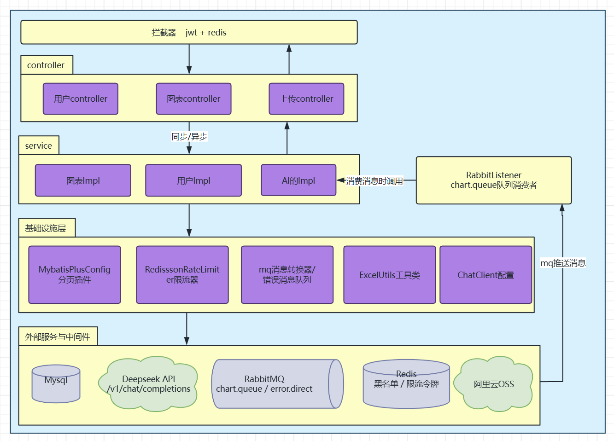
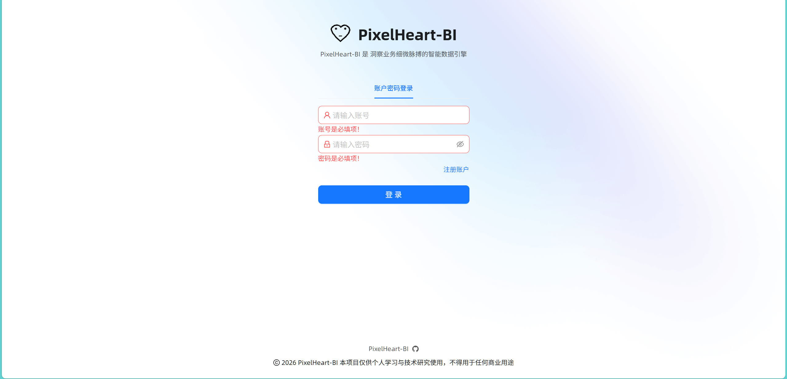
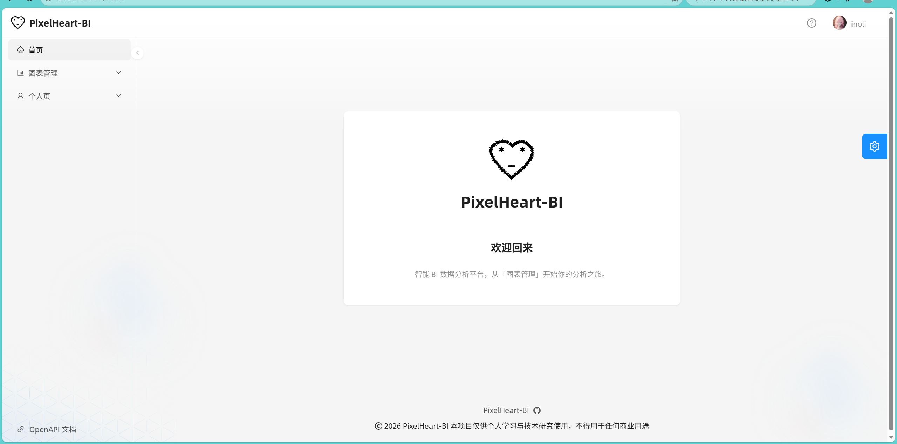
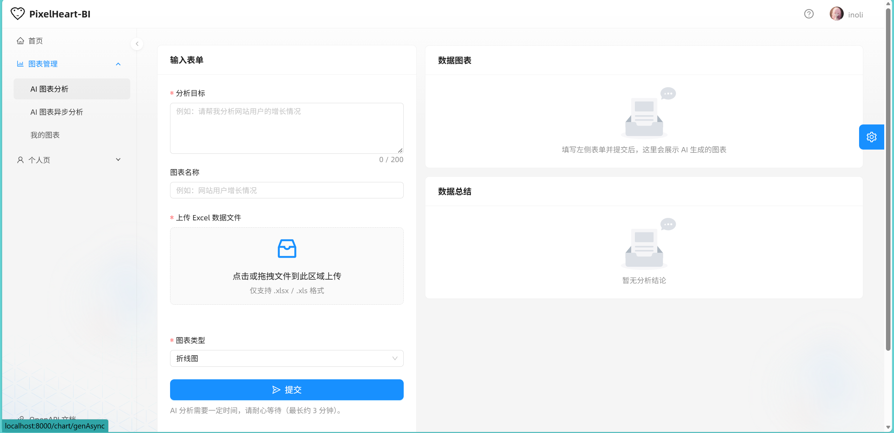
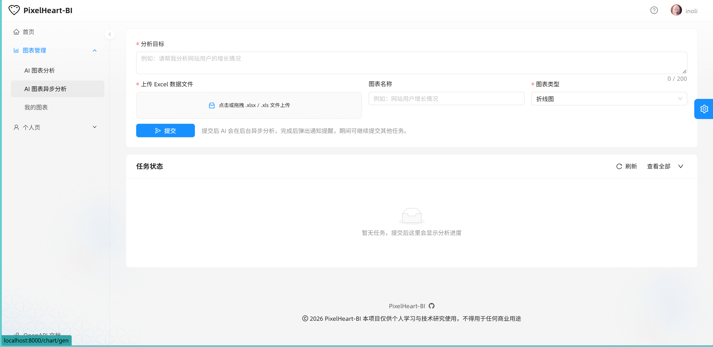
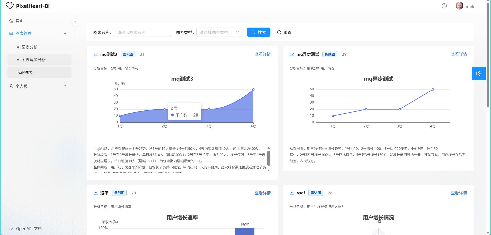
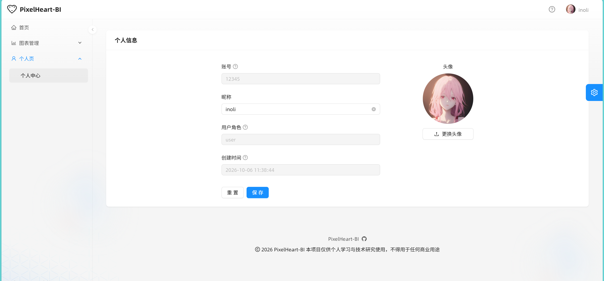
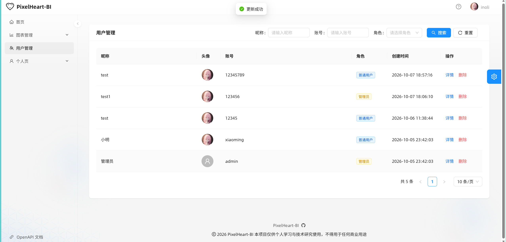

# PixelHeart-BI 智能数据分析平台

> 基于 Spring Boot 4 + Spring AI + DeepSeek 的智能 BI 数据分析与图表生成后端服务。用户上传 Excel 数据表并描述分析目标，服务调用大模型生成分析结论与 ECharts 图表代码，并落库管理。


---

## 1. 项目简介

PixelHeart-BI 是一个「AI 驱动的 BI 图表生成」后端服务，核心能力：

| 能力                     | 说明                                                         |
| :----------------------- | :----------------------------------------------------------- |
| **用户体系**             | 注册 / 登录（JWT）/ 退出（Redis 黑名单）/ 当前用户 / 管理员用户管理 |
| **智能图表生成（同步）** | 上传 Excel → Excel 转 CSV → 提交大模型 → 直接返回结论 + ECharts 代码 |
| **智能图表生成（异步）** | 上传 Excel → 落库为「等待中」→ 投递 RabbitMQ → 消费者调用大模型 → 回写状态与结果 |
| **图表管理**             | 分页条件查询（按当前用户隔离）、详情查询、逻辑删除           |
| **文件上传**             | 基于阿里云 OSS，按 `yyyy/MM/uuid.ext` 归档                   |
| **稳定性保障**           | Redisson 令牌桶限流、MQ 消费重试 + 失败重投、消息唯一 ID 幂等、消费端状态抢占 |

本项目为纯后端服务：接口返回 `genChart`（ECharts option 配置代码）与 `genResult`（文字结论），由前端负责渲染。

---

## 2. 技术栈

### 2.1 运行时与框架

| 分类       | 技术                        | 版本                     | 用途                                                         |
| :--------- | :-------------------------- | :----------------------- | :----------------------------------------------------------- |
| 语言       | Java                        | 21                       | record、文本块等新特性                                       |
| 基础框架   | Spring Boot                 | 4.0.8                    | Web / 自动装配 / 配置管理                                    |
| AI 框架    | Spring AI                   | 2.0.1（BOM）             | ChatClient、Advisor、ChatMemory                              |
| AI 模型    | DeepSeek（OpenAI 兼容协议） | deepseek-flash           | 通过 spring-ai-starter-model-openai 接入                     |
| 持久层     | MyBatis-Plus                | 3.5.17                   | mybatis-plus-spring-boot4-starter + mybatis-plus-jsqlparser 分页 |
| 数据库     | MySQL                       | 8.x（mysql-connector-j） | 用户、图表数据存储                                           |
| 缓存       | Spring Data Redis           | 随 Boot 4.0.8            | JWT 黑名单、Redisson 底层连接                                |
| 分布式工具 | Redisson                    | 4.7.0                    | RRateLimiter 分布式限流                                      |
| 消息队列   | Spring AMQP / RabbitMQ      | 随 Boot 4.0.8            | AI 分析任务异步解耦                                          |
| 认证       | JJWT                        | 0.12.6                   | JWT 签发（HS256）与解析                                      |
| 接口文档   | Knife4j（Boot 4 适配版）    | 5.7.6                    | OpenAPI3 文档 + 增强 UI                                      |
| Excel      | Alibaba EasyExcel           | 3.3.2                    | 读取 Excel 并转 CSV                                          |
| 对象存储   | 阿里云 OSS SDK              | 3.18.4                   | 文件上传                                                     |
| 工具库     | Hutool                      | 5.8.25                   | Bean 拷贝、BCrypt、UUID、文件工具                            |
| 序列化     | Jackson                     | 随 Boot                  | JSON/XML 消息转换                                            |
| 简化代码   | Lombok                      | 随 Boot                  | @Data/@Builder/@Slf4j                                        |

### 2.2 关键依赖坐标

```xml
<parent>spring-boot-starter-parent 4.0.8</parent>

spring-boot-starter-web
spring-boot-starter-data-redis
spring-boot-starter-amqp
spring-ai-starter-model-openai            <!-- BOM: spring-ai-bom 2.0.1 -->
mybatis-plus-spring-boot4-starter 3.5.17
mybatis-plus-jsqlparser 3.5.17
mysql-connector-j
com.baizhukui:knife4j-openapi3-boot4-spring-boot-starter 5.7.6
cn.hutool:hutool-all 5.8.25
io.jsonwebtoken:jjwt-api/impl/jackson 0.12.6
org.redisson:redisson 4.7.0
com.alibaba:easyexcel 3.3.2
com.aliyun.oss:aliyun-sdk-oss 3.18.4
com.fasterxml.jackson.dataformat:jackson-dataformat-xml
```

---

## 3. 系统架构

### 3.1 总体架构图



### 3.2 分层职责

| 层       | 包                                                   | 职责                                             |
| :------- | :--------------------------------------------------- | :----------------------------------------------- |
| 启动层   | `com.zzsd.pixelheartbi`                              | PixelHeartBiApplication，@MapperScan 扫描 Mapper |
| 接口层   | `controller`                                         | 参数接收、统一 Result 包装、Swagger 注解         |
| 拦截层   | `interceptor` / `config.WebConfig`                   | 登录态校验、ThreadLocal 写入与清理               |
| 业务层   | `service` / `service.impl`                           | 注册登录、图表生成与查询、AI 调用编排            |
| 模型层   | `entity`                                             | 实体 / DTO / VO / 枚举 / 分页模型                |
| 持久层   | `mapper` + `resources/mapper/*.xml`                  | MyBatis-Plus BaseMapper，XML 预留复杂 SQL        |
| 消息层   | `mq`                                                 | 队列监听、消息转换器、失败重投配置               |
| AI 层    | `config.ChatClientConfig` / `advisors` / `constants` | ChatClient 装配、系统提示词、日志 Advisor        |
| 基础设施 | `common` / `utils` / `exception`                     | 统一返回、限流器、JWT、Excel、OSS、全局异常      |

---

### 3.3效果截图















## 4. 核心业务流程

### 4.1 登录鉴权闭环

1. `POST /api/user/login`，校验账号密码，生成 JWT（有效期 12h）。
2. 后续请求携带 `header[token]`，拦截器 `preHandle` 校验 Redis 黑名单，并解析 JWT 将用户 ID 存入 `ThreadLocal`（`CurrentHolder`）。
3. `POST /api/user/logout`，将 token 以 `jwt:blacklist:{token}` 写入 Redis，TTL 取 token 剩余有效期。
4. **拦截器 `afterCompletion` 中调用 `CurrentHolder.remove()` 清理 ThreadLocal，防止内存泄漏与请求串号。**

### 4.2 同步生成图表（`/chart/getChartDataByAI`）

1. 客户端上传 Excel + 分析目标。
2. Redisson 限流（5 QPS/用户） → 后缀白名单校验 → Excel 转 CSV。
3. 调用 DeepSeek（带固定标记的系统提示词）。
4. `LlmResponseParser` 解析出结论与 ECharts 代码。
5. 落库，返回 `Result<Chart>`。

### 4.3 异步生成图表（`/chart/getChartDataByAIAsync` + RabbitMQ）

1. 客户端上传 Excel + 分析目标。
2. 限流 + 文件校验 + Excel 转 CSV。
3. 落库 `status = 0 (PENDING)`，投递 `chart.queue`（失败则置 `status = 3 FAILED`）。
4. 立即返回 `Result<Chart>(PENDING)`，前端凭 chartId 轮询状态。
5. 消费者监听：
   - 执行 `UPDATE chart SET status=1 RUNNING WHERE id=? AND status=0` 乐观抢占，实现幂等。
   - 调用 DeepSeek → 解析 → 回写 `gen_chart` / `gen_result` / `status=2 SUCCESS`。
   - 异常时置 `status=3 FAILED`，重试耗尽后消息重投 `error.direct` → `error.queue`。

### 4.4 RabbitMQ 拓扑与可靠性配置

| 可靠性项   | 实现                                                         |
| :--------- | :----------------------------------------------------------- |
| 消息幂等   | `JacksonJsonMessageConverter.setCreateMessageIds(true)` 生成唯一消息 ID |
| 业务幂等   | 消费者用 `UPDATE ... WHERE status = PENDING` 乐观抢占，重复消息直接跳过 |
| 消费重试   | `listener.simple.retry` 开关 + 3 次重试、初始 1s、倍数 2     |
| 失败兜底   | `RepublishMessageRecoverer` 把最终失败消息重投到 `error.direct` → `error.queue` |
| 生产者确认 | 当前关闭（`publisher-confirm-type: none`、`publisher-returns: false`），由 `try/catch` + 状态置失败兜底 |

### 4.5 大模型输出协议（提示词工程）

系统提示词强制模型以固定标记分段输出，便于程序解析：

```text
<<<CONCLUSION>>>
分析结论（纯文本）
<<<END_CONCLUSION>>>
<<<ECHARTS>>>
option = { ... };   // 可直接执行的 ECharts 配置，禁止 Markdown 包裹
<<<END_ECHARTS>>>
```

`LlmResponseParser` 的解析策略（含兜底）：

1. 按 `<<<CONCLUSION>>>`/`<<<END_CONCLUSION>>>` 提取结论；
2. 按 `<<<ECHARTS>>>`/`<<<END_ECHARTS>>>` 提取图表代码；
3. ECharts 段缺失 → 回退提取 ` ``` ` 代码块内容；
4. 结论段缺失 → 取第一个 ECharts 标记之前的文本；
5. 统一清洗残留的 Markdown 围栏。

---

### 5.1 前置条件

| 组件             | 版本建议 | 必需          | 备注                             |
| :--------------- | :------- | :------------ | :------------------------------- |
| JDK              | 21+      | ✅             | 项目 java.version = 21           |
| Maven            | 3.9+     | ✅             | 或直接使用 `./mvnw`              |
| MySQL            | 8.0+     | ✅             | 需先执行建表语句                 |
| Redis            | 6+       | ✅             | JWT 黑名单 + Redisson 限流       |
| RabbitMQ         | 3.9+     | ✅（异步接口） | 需创建 vhost 与 chart.queue 队列 |
| 阿里云 OSS       | -        | ⭕（上传接口） | 需配置 AK/SK 环境变量            |
| DeepSeek API Key | -        | ✅（AI 接口）  | 需可访问 api.deepseek.com        |

## 10. 关键设计要点

| 主题                  | 设计说明                                                     |
| :-------------------- | :----------------------------------------------------------- |
| **统一返回**          | `Result<T>{code,msg,data}`，配合 `@RestControllerAdvice` 全局异常处理器，避免前端拿到无响应体的 500 |
| **无状态认证**        | JWT HS256，载荷 `{id, userAccount}`，有效期 12 小时；解析结果写入 `CurrentHolder`（ThreadLocal），并在 `afterCompletion` 中 `remove()` 防止线程复用污染与内存泄漏 |
| **主动登出**          | `POST /user/logout` 把 token 以 `jwt:blacklist:{token}` 写入 Redis，TTL 取 token 剩余有效期，天然自动过期 |
| **分布式限流**        | Redisson `RRateLimiter`，`RateType.OVERALL` 5 令牌/秒，按 `业务名_userId` 分桶 |
| **异步解耦**          | 耗时的大模型调用交给 RabbitMQ 消费者，接口先落库 PENDING 快速返回，前端凭 chartId 轮询状态 |
| **状态机 + 乐观抢占** | 消费者先执行 `UPDATE chart SET status=RUNNING WHERE id=? AND status=PENDING`，仅当影响行数为 1 才继续，天然实现消费幂等 |
| **MQ 可靠性**         | 自动 ack + prefetch 1 + 3 次指数重试 + `RepublishMessageRecoverer` 重投 `error.queue`；消息转换器开启唯一消息 ID |
| **提示词约束**        | 用固定标记 `<<<CONCLUSION>>>` / `<<<ECHARTS>>>` 约束模型输出结构，解析器多级兜底 |
| **AI 可观测**         | 自定义 `MyLogAdvisor` 同时实现 CallAdvisor 与 StreamAdvisor，统一打印 AI 请求与响应 |
| **数据隔离**          | 图表列表查询强制拼接 `user_id = CurrentHolder.getCurrentId()`，用户只能看到自己的数据 |
| **逻辑删除**          | MyBatis-Plus 全局配置 `isDelete`（1 已删 / 0 未删）          |
| **配置外置**          | 敏感信息通过 `application-local.yml`（gitignore）+ 环境变量注入 |

---

*PixelHeart-BI · Spring Boot 4 × Spring AI × DeepSeek*
